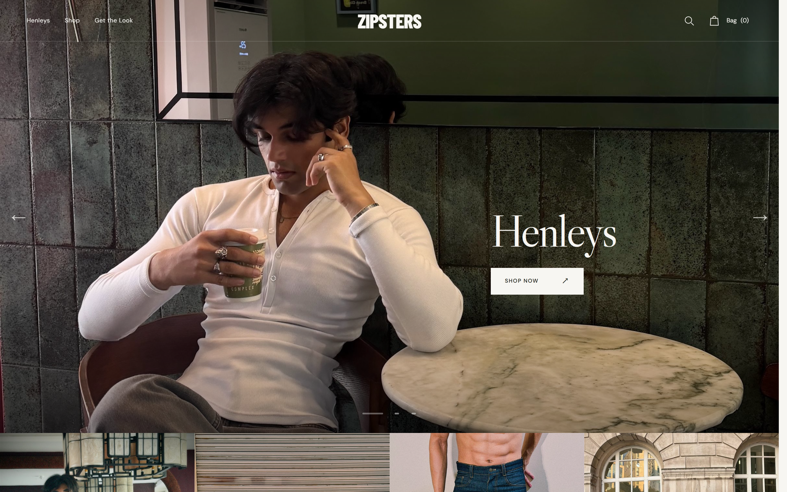
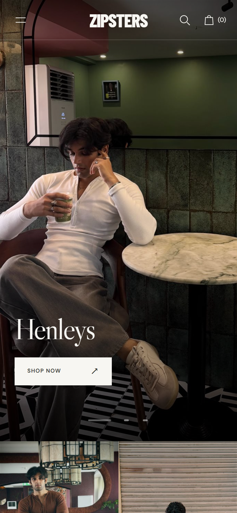
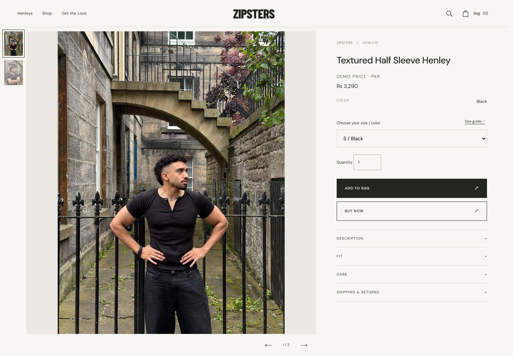

# ZIPSTERS — Custom Shopify Theme & Fashion E-commerce Experience

A premium fashion storefront project combining editorial design, responsive development, and interactive shopping experiences.

Built with a focus on **brand identity, visual storytelling, seamless navigation, and thoughtful e-commerce interactions.**

**[Explore Live Demo](https://zipsters-demo.vercel.app/)** · **[View GitHub Repository](https://github.com/PobGare/zipsters)**

> **Demo information:** The public preview is a standalone portfolio demonstration, not a connected Shopify store. Checkout is simulated; no actual orders or payments are processed.

---

## Project Overview

ZIPSTERS showcases a custom fashion e-commerce experience designed to give a clothing brand a distinctive digital presence.

The project brings together bold visual presentation, carefully structured product collections, responsive layouts, and intuitive shopping interactions.

Rather than relying on a generic storefront experience, the design emphasizes the brand's products through strong imagery, intentional typography, clean layouts, and smooth transitions.

The repository contains both a **custom Shopify Liquid theme** and an **independently hosted storefront demo**.

The public demo allows visitors to explore the design and shopping interactions without requiring a live Shopify store.

This repository demonstrates the storefront implementation. It does not independently establish a commissioned engagement, brand endorsement, or production deployment.

---

## Project Showcase

### Desktop Homepage

An editorial homepage featuring the Henleys campaign, category discovery, product showcases, and fashion-focused storytelling.



### Mobile Experience

Responsive navigation, carefully adapted layouts, and touch-friendly shopping interactions.



### Product Detail Page

An interactive product presentation with image galleries, product information, size selection, and purchase controls.



**[Explore the Interactive Demo](https://zipsters-demo.vercel.app/)**

---

## Key Features

### Premium Storefront Design

- Custom fashion-focused visual direction
- Automatic hero slideshow with smooth transitions
- Editorial product photography and engaging campaign sections
- Responsive category navigation
- Best Sellers product showcase
- Get the Look section featuring fashion content
- Carefully designed header, navigation, and footer
- Consistent typography, spacing, and responsive layouts

### Interactive Product Pages

- Product galleries with thumbnail navigation
- Interactive image controls
- Responsive product presentation
- Product details and size selection interfaces
- Add to Bag and Buy Now interactions
- Related product recommendations
- Mobile-friendly browsing and touch interactions

### Shopping Experience

- Product search and suggestions
- Collection filtering and sorting
- Interactive shopping bag drawer
- Persistent cart functionality in the standalone demo
- Responsive mobile navigation
- Smooth drawer transitions and scroll management
- Simulated checkout flow for demonstration purposes

### Responsive Development

The experience is designed for desktop, tablet, and mobile devices, with attention to:

- Responsive imagery and layouts
- Mobile-first navigation considerations
- Touch-friendly controls
- Product gallery usability
- Readable typography and spacing
- Consistent shopping interactions across screen sizes

---

## Technology Stack

| Technology | Purpose |
|---|---|
| Shopify Liquid | Custom Shopify theme templates and sections |
| HTML5 | Semantic storefront structure |
| CSS3 | Responsive layouts, styling, and animations |
| JavaScript | Product interactions, navigation, search, filters, and cart functionality |
| Node.js | Standalone demo rendering and supporting functionality |
| Vercel | Deployment of the public portfolio demo |
| Git & GitHub | Version control and project maintenance |

---

## Shopify Theme & Standalone Demo

The project includes two separate implementations.

### Custom Shopify Theme

The original Shopify Liquid theme is developed for integration with the Shopify platform.

It includes custom templates, storefront sections, responsive styling, and interactive shopping features.

Connecting the theme to a production store requires Shopify configuration, a live product catalog, inventory, applicable policies, payment setup, and shipping settings.

### Standalone Portfolio Demo

The [public demo](https://zipsters-demo.vercel.app/) recreates the storefront experience independently of Shopify.

Visitors can explore the homepage, collections, product detail pages, navigation, shopping bag, search, and other interactive features.

The demo uses sample product data and simulated checkout functionality.

**The hosted demo does not process payments, create real orders, or represent a production Shopify storefront.**

---

## Project Structure

| Directory | Purpose |
|---|---|
| `theme/` | Original Shopify Liquid theme |
| `portfolio-demo/` | Independently runnable storefront demo, assets, sample catalog, and tests |
| `assets/` | Original photography and retained media renditions |
| `research/` | Catalog provenance, licensing information, and historical quality-assurance records |
| `scripts/` | Preview tooling, validation scripts, packaging utilities, and historical generators |

The Shopify theme and portfolio demo are maintained separately.

Some media assets are intentionally retained in both implementations. Historical asset generators and cleanup scripts should not be run as routine setup without reviewing their documented purpose.

---

## Local Development

### Requirements

- Node.js 24
- npm

### Run the Standalone Demo

From the repository root:

```bash
cd portfolio-demo
npm ci
npm run dev
```

Open:

`http://localhost:4174`

### Test the Demo

In another terminal, from `portfolio-demo/`:

```bash
npm test
npm run audit
npm run build
npm run verify:function
```

The build generates static assets, while the Vercel Node function handles page rendering. The `dist` directory by itself is not a complete runnable storefront.

### Run the Shopify Theme Preview

From the repository root:

```bash
npm ci
npm run dev
```

Open:

`http://localhost:4173`

### Validate the Shopify Theme

From the repository root:

```bash
npm run check
npm run audit
```

The root `check` command validates Liquid and JSON files. The root audit requires the local preview server to be running.

For additional technical details, see the [Script Guide](scripts/README.md).

---

## Development & Quality Assurance

The project includes automated checks and maintenance documentation for the standalone demo and Shopify theme preview.

Areas covered include:

- Storefront functionality
- Navigation and interactive elements
- Responsive behavior
- Build verification
- Theme file validation
- Browser-based checks
- Dependency and maintenance review

The hosted demo is operational. Earlier startup issues are documented as historical maintenance items rather than current limitations.

For current verification details, known limitations, and dependency information, see the [Maintenance Report](portfolio-demo/qa/MAINTENANCE.md).

---

## Media & Asset Rights

ZIPSTERS uses fashion imagery and related media assets documented in the repository's provenance records.

Media attribution and source information do not automatically grant rights to redistribute or commercially reuse those assets.

The repository's [Asset Rights Documentation](ASSET_RIGHTS.md) identifies known permission gaps and references the relevant provenance information.

Written authorization for public portfolio use or redistribution should be retained where required. The repository does not independently establish that all necessary permissions have been granted.

Font license information is included in the project documentation.

---

## About the Developer

I'm **Muhammad Bin Qasim**, a web developer focused on creating responsive websites, custom storefronts, and interactive digital experiences.

I enjoy combining visual design with practical development to build interfaces that feel polished, intuitive, and purposeful.

My work includes business websites, Shopify theme customization, e-commerce experiences, and modern web applications.

---

## Let's Connect

I'm open to freelance projects, collaborations, internships, and web development opportunities.

**[Portfolio](https://pobgare.github.io/portfolio/)** · **[LinkedIn](https://www.linkedin.com/in/muhammad-bin-qasim-dev/)** · **[Upwork](https://www.upwork.com/freelancers/~01d4fed98b3719bd6e?mp_source=share)** · **[Fiverr](https://www.fiverr.com/pobgarre)** · **[GitHub](https://github.com/PobGare)**

*Building better digital experiences, one project at a time.*

---

© 2026 Muhammad Bin Qasim
