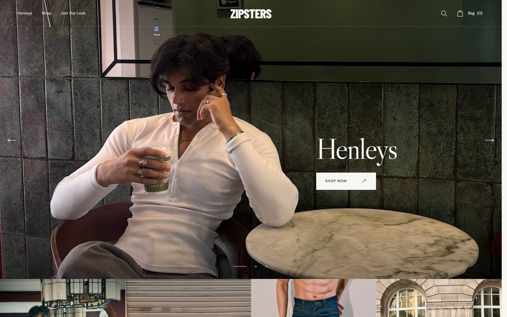
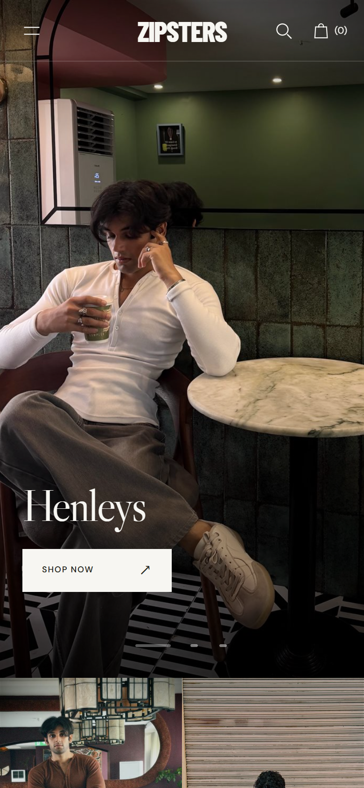
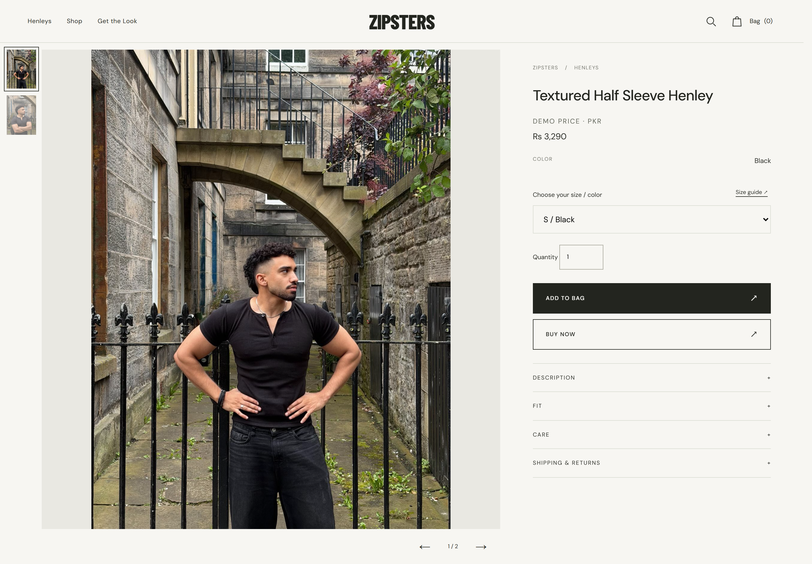

# ZIPSTERS — Shopify Fashion Storefront

**A custom-built fashion e-commerce experience, combining editorial design with modern storefront functionality.**

[**Live Website**](https://zipsters-demo.vercel.app) | [**GitHub Repository**](https://github.com/PobGare/zipsters)

---

## Project Overview

ZIPSTERS is a custom Shopify storefront developed for a contemporary fashion brand.

The project focuses on creating a premium shopping experience through strong visual storytelling, responsive layouts, intuitive product discovery, and smooth interactions.

Built with a mobile-first mindset, the storefront combines fashion-focused presentation with practical e-commerce functionality.

## Preview

Captured from the standalone demo in Chromium at 2× device pixel ratio. Click any preview to view the full-resolution image.

### Desktop Homepage

### Mobile Experience

  

### Product Detail Page

## Key Features

### Homepage & Visual Experience

- Automatic hero slideshow with smooth transitions
- Responsive product category navigation
- Best Sellers showcase
- Editorial product photography
- Get the Look section with fashion content
- Responsive header, navigation, and footer

### Product Pages

- Interactive product image galleries
- Thumbnail navigation and image controls
- Mobile-friendly product browsing
- Product information and details
- Add to Bag and Buy Now interfaces
- Related product recommendations

### Shopping Experience

- Product search and suggestions
- Collection filtering and sorting
- Interactive shopping bag drawer
- Persistent cart in the standalone demo
- Responsive navigation and mobile menu
- Smooth transitions and carefully managed scrolling

## Technology Stack

- **Shopify Liquid** — Custom theme templates and sections
- **HTML5** — Semantic page structure
- **CSS3** — Responsive layouts, styling, and animations
- **JavaScript** — Interactive storefront functionality
- **Node.js** — Standalone demo rendering and supporting functionality
- **Vercel** — Public deployment of the standalone demo

## Shopify Theme & Live Demo

The repository contains the original Shopify theme and a separate standalone portfolio demo.

The original theme is designed for integration with a Shopify store.

The [live demo](https://zipsters-demo.vercel.app) recreates the storefront experience independently of Shopify so visitors can explore its layout, product pages, navigation, search, filters, and shopping interactions.

**Note:** The standalone demo uses illustrative product data and simulated checkout functionality. It does not process real orders or payments.

## Responsive Design

ZIPSTERS is designed for desktop, tablet, and mobile browsing, with particular attention to:

- Responsive image presentation
- Touch-friendly navigation
- Consistent typography and spacing
- Mobile product galleries
- Smooth shopping interactions
- Usable layouts across screen sizes

## Development & Testing

The standalone demo was tested with automated checks and desktop/mobile browser testing covering core storefront functionality.

The Shopify theme is maintained separately from the demo implementation.

## Developer

**Muhammad Bin Qasim**  
Web Developer

[Portfolio](https://pobgare.github.io/portfolio/) | [GitHub](https://github.com/PobGare)

---

*Developed as a custom fashion e-commerce storefront project.*
